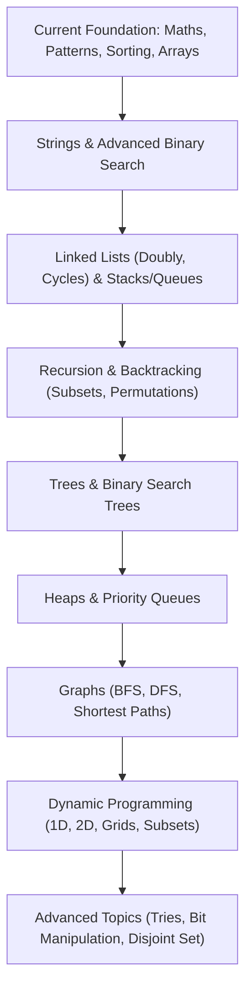

# Learning Progress Tracker

This document tracks my personal Data Structures and Algorithms (DSA) learning journey in Java. The metrics reflect actual code implementations available in this repository.

---

## 1. Topic-Wise Learning Tracker

| Topic | Problems Available | Status |
| :--- | :---: | :--- |
| **Patterns** | 22 | Practised |
| **Basic Maths** | 10 | Practised |
| **Recursion** | 8 | Practised |
| **Sorting** | 7 | Practised |
| **Arrays** | 32 | Practised |
| **Hashing** | 6 | Practised |
| **Two Pointers** | 6 | Practised |
| **Sliding Window** | 1 | In Progress |
| **Binary Search** | 2 | In Progress |
| **Linked List** | 1 | In Progress |
| **Stack & Queue** | 3 | In Progress |
| **Strings** | 1 | In Progress |
| **Trees & BST** | 0 | Not Started |
| **Heaps / Priority Queue** | 0 | Not Started |
| **Graphs** | 0 | Not Started |
| **Greedy Algorithms** | 0 | Not Started |
| **Dynamic Programming** | 0 | Not Started |
| **Tries** | 0 | Not Started |
| **Bit Manipulation** | 1 | In Progress |

*Total Java Source Files in Repository: **90***

---

## 2. Topic Details & Completed Implementations

### Patterns (22/22 Practised)
- All 22 classic geometric, numerical, and alphabetical patterns from Striver's A2Z sheet.
- Right-angled triangles, inverted pyramids, diamonds, butterfly patterns, hollow squares, and concentric number grids (`pattern22.java`).

### Basic Maths (10 Practised)
- Digit extraction and counting (`count_digits.java`)
- Palindrome number check (`pallindrome_num.java`)
- Armstrong / Narcissistic numbers (`Amstrong_num.java`)
- Prime number check using $O(\sqrt{N})$ trial division (`prime_num_check.java`)
- Print all divisors in $O(\sqrt{N})$ with sorting (`print_all_divisors.java`)
- GCD / HCF computation (`gcd.java`)
- Factorial using tail-recursion (`factorial.java`)
- Fibonacci sequence generator (`fibonacci.java`)
- Direct array frequency hashing (`hashing.java`)
- String palindrome verification (`String_pallindrome.java`)

### Recursion (8 Practised)
- Print 1 to N and N to 1 recursively (`print_1_to_N.java`, `print_N_to_1.java`)
- Recursive string printing and counter tracking (`name_recursion.java`, `recursion.java`)
- Sum of first N numbers (`sum_recursion.java`)
- Iterative digit reversal (`reverse_num.java`)
- Recursive Bubble Sort (`rec_bubble_sort.java`)
- Recursive Insertion Sort (`rec_insertion_sort.java`)

### Sorting Algorithms (7 Practised)
- Selection Sort ($O(N^2)$)
- Bubble Sort ($O(N^2)$)
- Insertion Sort ($O(N^2)$)
- Merge Sort ($O(N \log N)$ Divide & Conquer)
- Quick Sort ($O(N \log N)$ Lomuto Partition)
- Binary Search (Iterative search on sorted array)
- Helper class for swap utilities (`Swap.java`)

### Arrays (32 Practised)
- **Foundational & Rotation**:
  - Check if array is sorted (`array_sorted_check.java`)
  - Reverse array in-place (`reverse_array.java`)
  - Left rotate by 1 (`left_arr_ro1.java`)
  - Rotate array right by K places (`arr_ro_k_times.java`)
  - Move zeros to end (`move_zeros_to_end.java`)
- **Extremes & Leaders**:
  - Largest element in array (`largest_ele_arr.java`)
  - Second largest and second smallest elements (`sec_large_small_arr.java`)
  - Leaders in an array (`leader_arr.java`)
- **Multi-Approach Problem Solving**:
  - **Two Sum**:
    - Brute Force ($O(N^2)$ nested loops)
    - Better (Sorting + Two Pointers, $O(N \log N)$)
    - Optimal (HashSet lookups, $O(N)$)
  - **Sort an Array of 0s, 1s, and 2s**:
    - Brute Force (Merge Sort, $O(N \log N)$)
    - Better (Counting Sort, $O(2N)$)
    - Optimal (Dutch National Flag Algorithm, $O(N)$ one-pass)
  - **Longest Subarray with Sum K**:
    - Brute Force ($O(N^2)$)
    - Better (Prefix Sum + HashMap, $O(N)$ for all integers)
    - Optimal (Two Pointers / Sliding Window, $O(2N)$ for non-negatives)
  - **Find Element Appearing Once**:
    - Better (HashMap frequency mapping, $O(N)$ space)
    - Optimal (Bitwise XOR cancellation, $O(1)$ space)
  - **Union & Intersection of Sorted Arrays**:
    - Union via `TreeSet` ($O((N_1 + N_2) \log(N_1 + N_2))$)
    - Optimal Union via Two Pointers ($O(N_1 + N_2)$)
    - Optimal Intersection via Two Pointers ($O(N_1 + N_2)$)
  - **Other Problems**:
    - Maximum consecutive ones (`optimal_max_cons_1_arr.java`)
    - Missing number using summation formula (`optimal_missing_num_arr.java`)
    - Next Permutation using Narayana Pandita's algorithm (`next_permutation.java`)
    - All Array Permutations using Backtracking (`Permutation.java`)

### Data Structures & Course Series (`dsa_telusko/` - In Progress)
- **Linked List**: Singly Linked List with insertion at head, tail, and custom index, plus traversal (`Linked_List.java`).
- **Stack**: Array-based stack implementation with push, pop, peek, overflow/underflow handling (`Stack_array.java`).
- **Queue**: Circular queue implementation using array and modulo arithmetic (`Queue.java`).
- **Linear Search**: Linear search traversal (`Linear_Search.java`).

---

## 3. Future Learning Roadmap

The following topics represent the next phases in my DSA curriculum:

### Detailed Topic Plans

1. **Strings**:
   - Reverse words in a string, Roman to Integer, Valid Anagram, Longest Common Prefix
   - String pattern matching (KMP, Rabin-Karp)
2. **Binary Search (Advanced)**:
   - Search in Rotated Sorted Array
   - Find Minimum in Rotated Sorted Array
   - Binary Search on Answer space (Book Allocation, Aggressive Cows, Koko Eating Bananas)
3. **Linked Lists**:
   - Doubly Linked List implementation
   - Reverse a linked list (Iterative and Recursive)
   - Detect and find entry of cycle (Floyd's Tortoise and Hare)
   - Merge two sorted linked lists, Remove N-th node from end
4. **Stack & Queue**:
   - Complete Linked List based stack implementation
   - Valid Parentheses
   - Monotonic Stack problems (Next Greater Element, Trapping Rain Water, Largest Rectangle in Histogram)
   - Min Stack implementation
5. **Recursion & Backtracking**:
   - Subsets & Subsequences (Power Set)
   - Combination Sum I & II
   - N-Queens Problem, Sudoku Solver
6. **Trees & BST**:
   - Binary Tree Traversals (Inorder, Preorder, Postorder, Level Order)
   - Height, Diameter, Balanced Tree check
   - Lowest Common Ancestor (LCA)
   - Binary Search Tree operations (Insert, Search, Delete, Validate BST)
7. **Heaps / Priority Queues**:
   - Min-Heap and Max-Heap implementations
   - K-th Largest / Smallest Element
   - Merge K Sorted Lists
8. **Graphs**:
   - Graph representations (Adjacency Matrix, Adjacency List)
   - Traversals: Breadth First Search (BFS), Depth First Search (DFS)
   - Cycle detection in Directed and Undirected graphs
   - Topological Sort (Kahn's Algorithm)
   - Shortest Path algorithms: Dijkstra's Algorithm, Bellman-Ford
   - Disjoint Set Union (DSU) and Minimum Spanning Tree (Kruskal, Prim)
9. **Greedy Algorithms**:
   - Activity Selection, N Meetings in One Room, Fractional Knapsack
10. **Dynamic Programming**:
    - Introduction to Memoization & Tabulation
    - 1D DP: Climbing Stairs, House Robber, Frog Jump
    - 2D / Grid DP: Unique Paths, Minimum Path Sum
    - DP on Subsets: 0/1 Knapsack, Subset Sum
    - DP on Strings: Longest Common Subsequence (LCS), Edit Distance
    - DP on Stocks
11. **Tries**:
    - Implement Trie (Prefix Tree)
    - Autocomplete, Longest word with all prefixes
12. **Bit Manipulation**:
    - Bitwise operations, Set/Clear/Toggle bit
    - Power of Two check, Count set bits, Two non-repeating numbers

